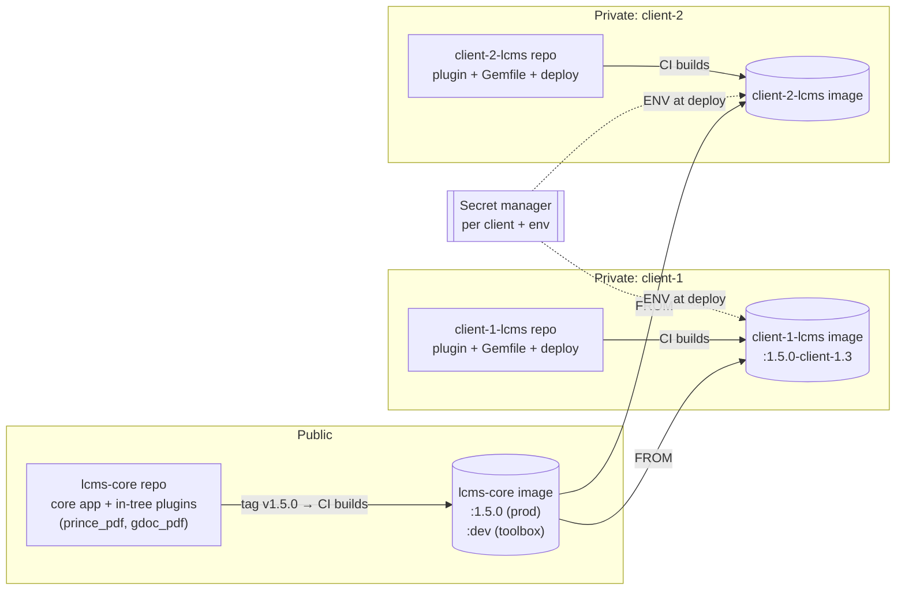
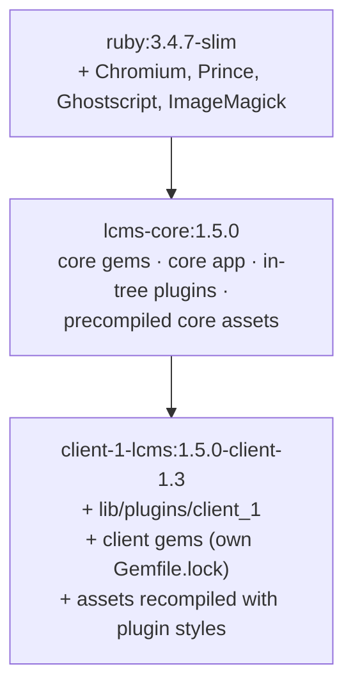
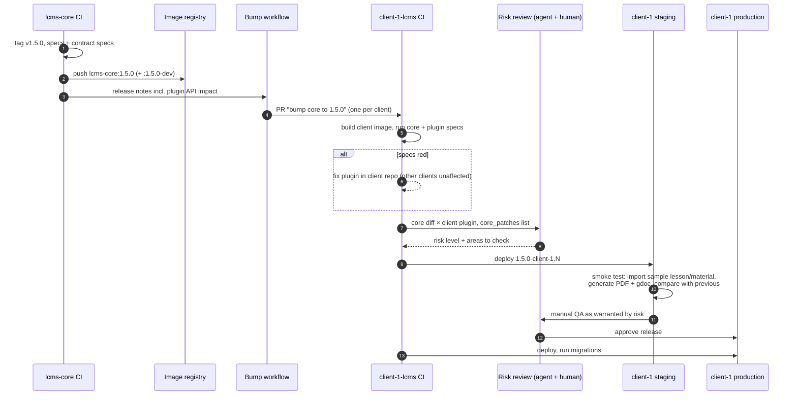
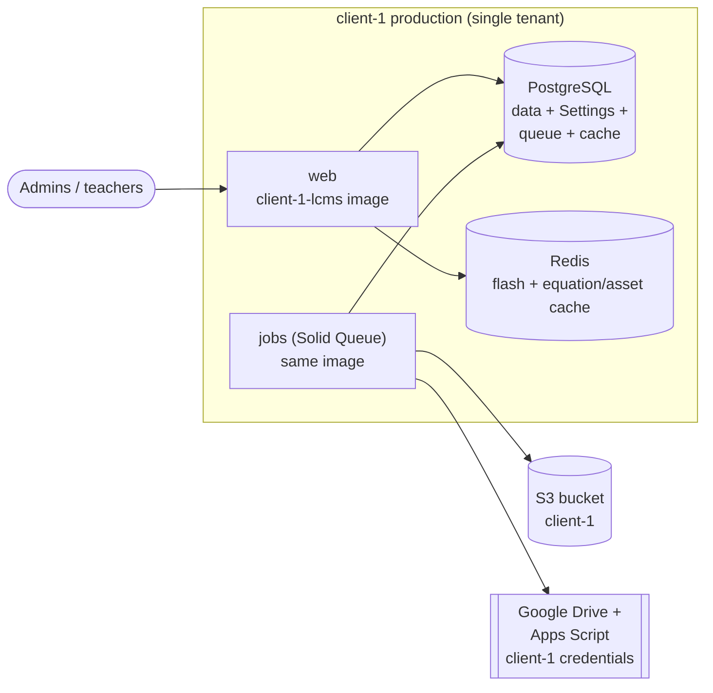
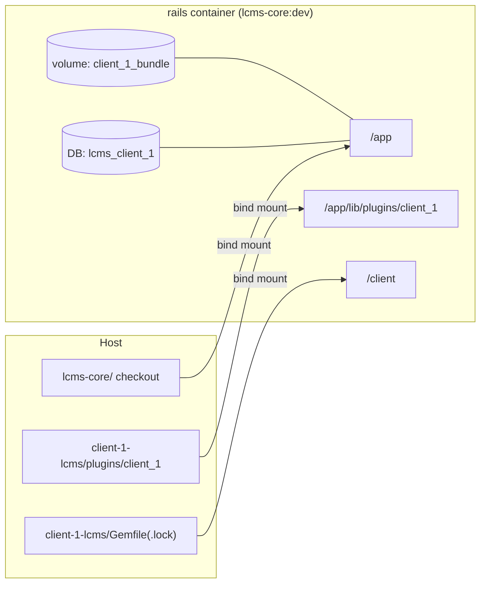

# ADR-0003: Client Distribution and Release Model

|                   |                                                                                                                  |
|-------------------|------------------------------------------------------------------------------------------------------------------|
| **Status**        | Proposed                                                                                                         |
| **Date**          | 2026-09-25                                                                                                       |
| **Supersedes**    | —                                                                                                                |
| **Superseded by** | —                                                                                                                |
| **Related**       | [ADR-0004](./0004-stable-plugin-api.md), [ADR-0001](./0001-pluggable-output-renderers.md), [docs/plugin-system.md](../plugin-system.md) |

---

## 1. Context

LCMS Core replaces the previous model where every client had its own Rails
application built on the `lcms-engine` gem. In that model client apps grew
large and diverged from the engine:

| Client app     | Tracked files in `app/` + `lib/` | Overridden/added views | Decorators |
|----------------|----------------------------------|------------------------|------------|
| Client 1       | ~710                             | 243                    | 26         |
| Client 2       | ~910                             | 120                    | 21         |
| Client 3       | ~715                             | 193                    | 18         |

Most of these customizations patched engine internals (decorators, same-path
view overrides). Every engine upgrade was therefore a separate project per
client.

LCMS Core is a standalone, open-source (Apache 2.0) application in a single
repository. The business goals are:

1. Deliver core updates to all clients from one codebase, with a much lower
   cost per client update than before.
2. Let clients customize what they need — lesson and material templates,
   metadata, styling — without forking core.
3. Keep client-specific code and configuration out of the public repository.

Updating a client is **not** expected to be fully automated or free. The goal
is to make it cheap and predictable: failures are found by CI before release,
not by the client after it.

### 1.1 Problems with the current setup

- **Plugins have no stable API.** [docs/plugin-system.md](../plugin-system.md)
  promises plugins "full access" to all models, services and helpers. Nothing
  marks what is public, so any core refactor can break any client plugin.
  Enabling a plugin only on its client's instance isolates clients from each
  other, but does not protect a client plugin from core changes.
- **Core CI cannot see client plugins.** Client plugins are private, so a core
  release can be green and still break a client, sometimes silently (an
  override that no longer matches renders the core default without error).
- **Plugins cannot override core views.** [config/plugin_paths.rb](../../config/plugin_paths.rb)
  appended plugin view paths after the app's, so core templates always won.
  Overriding lesson/material templates required monkeypatching. *Fixed:*
  plugin view paths are prepended, limited to a declared list of templates
  and checked by a spec ([plugin-api.md §6](../plugin-api.md)).
- **Plugin dependencies leak into core.** The main `Gemfile` runs
  `eval_gemfile` over `lib/plugins/*/Gemfile`, and plugin migrations are dumped
  into `db/schema.rb`. `plugin_demo` already put `acts-as-taggable-on` into
  core's `Gemfile.lock` and `tags`/`taggings` into core's schema.
- **All discovered plugins load.** Anything under `lib/plugins/` is loaded;
  there is no per-deployment enablement and no core-version compatibility check.
- **Private submodules do not fit a public repository.** They expose private
  URLs in `.gitmodules` and break `git clone --recursive` for outsiders.
- **Production image and plugin gems.** The production `Dockerfile` runs
  `bundle install` (with `BUNDLE_DEPLOYMENT=1`) after copying only `Gemfile`,
  `Gemfile.lock` and `vendor`, before plugin Gemfiles are present. Verified:
  with `plugin_demo` declaring `acts-as-taggable-on`, frozen-mode Bundler
  aborts ("Some dependencies were deleted from your gemfile"), so the image
  did not build. *Fixed:* the Dockerfile now stages the in-tree plugin
  Gemfiles before `bundle install`, and CI builds the production image.

## 2. Decision

### 2.1 Core is a versioned product

- The public `lcms-core` repository publishes **semver releases** (git tags)
  and a matching container image, `learningtapestry/lcms-core:X.Y.Z`.
- Core ships generic, reusable functionality only. A feature that two or more
  clients plausibly need belongs in core, behind a setting or an extension
  point (e.g. `prince_pdf`, `gdoc_pdf`).
- Core exposes a **stable plugin API** defined in [ADR-0004](./0004-stable-plugin-api.md).
  Its compatibility rules drive the version number: breaking the plugin API
  requires a major version.

Repositories and artifacts. Examples use two placeholder clients: repositories
are named `client-N-lcms`, and the plugin directory is `client_N` (it must be a
valid Ruby module name, `ClientN`).



- The public repository knows nothing about clients.
- A client image tag carries both versions:
  `<core version>-<client>.<client build>`, e.g. `1.5.0-client-1.3`.

### 2.2 Each client has a private distribution repository

Client code never lives in the public repository, unless the client explicitly
wants an open-source solution. Each client gets a private repository:

```
<client>-lcms/                    # private
  Dockerfile                      # FROM learningtapestry/lcms-core:X.Y.Z
  Gemfile                         # eval_gemfile core's Gemfile + client gems
  Gemfile.lock                    # client lockfile (core's lockfile is never touched)
  docker-compose.yml              # local development (see 2.7)
  plugins/<client>/               # the client plugin (plugin layout per docs/plugin-system.md)
  spec/                           # plugin specs + end-to-end smoke checks
  deploy/                         # deploy definition per environment (staging, production)
  .github/workflows/              # build, test, release pipeline
```

**One plugin per client.** All of a client's customizations live in a single
client plugin. Shared functionality ships with core as in-tree plugins
(e.g. `prince_pdf`, `gdoc_pdf`), which a client enables rather than copies
(`LCMS_PLUGINS=prince_pdf,<client>`). Private code needed by several clients
is moved into core as an in-tree plugin instead of being shared privately.
This keeps one manifest, one `requires_core`, one Gemfile/lockfile and one
place for patches per client, with no inter-plugin dependencies to manage.

The client image is built from the core image: copy the client plugin into
`lib/plugins/`, install the client gems, precompile assets. The core version is
pinned in exactly one place (`FROM`).



A sketch of the client image build:

```dockerfile
# client-1-lcms/Dockerfile
ARG CORE_VERSION=1.5.0
FROM learningtapestry/lcms-core:${CORE_VERSION}

COPY Gemfile Gemfile.lock /client/
ENV BUNDLE_GEMFILE=/client/Gemfile
RUN bundle install

COPY plugins/client_1 /rails/lib/plugins/client_1
RUN SECRET_KEY_BASE_DUMMY=1 bin/rails assets:precompile
```

The client `Gemfile` extends core's instead of changing it:

```ruby
# client-1-lcms/Gemfile
eval_gemfile File.join(ENV.fetch("LCMS_CORE_PATH", "/rails"), "Gemfile")

gem "combine_pdf" # client-only gems
```

Core's `Gemfile.lock` is never modified by a client. The client lockfile is
committed in the client repository.

A repository template is maintained so new clients start from the same layout.

### 2.3 Configuration is split into three layers

| Layer                     | Where it lives                                       | Examples                                                       |
|---------------------------|------------------------------------------------------|----------------------------------------------------------------|
| Secrets / infrastructure  | Secret manager → ENV, per client and environment     | DB, S3, Google credentials, `DEFAULT_PDF_RENDERER`             |
| Deployment definition     | Client repository (`deploy/`)                        | Image tag, hosts, enabled plugins, resources                   |
| Business configuration    | Database (`Settings`), edited in admin               | Appearance, PDF options, callout types, metadata label maps    |

- No client configuration and no secrets in the public repository.
  `config/deploy.yml` in core stays a generic template.
- Domain configuration that is still file-based in core
  (`config/tags.yml`, `config/materials_rules.yml`) moves to `Settings`, the
  same way as the `pdf.yml` → DB work.

### 2.4 Plugin loading changes in core

1. **Plugin manifest.** Each plugin declares its name, version and the core
   versions it supports (`requires_core: "~> 1.4"`). Boot fails when the
   running core version does not satisfy it.
2. **Explicit enablement.** Plugins are enabled per deployment
   (e.g. `LCMS_PLUGINS=prince_pdf,client_1`). Present but not enabled means not
   loaded — no autoload paths, routes, migrations, views or `setup!`.
3. **Plugin schema stays out of core.** Plugin tables use a plugin prefix and
   are excluded from core's `db/schema.rb`; plugin gems stay out of core's
   `Gemfile.lock`. `plugin_demo` is moved out of core's lockfile and schema
   (or out of the repository into an example repository).
4. **Production build supports plugin gems.** The build installs plugin gems
   from the client's own Gemfile/lockfile via `BUNDLE_GEMFILE` (see 2.2). Core's
   `Gemfile` globs only in-tree plugin Gemfiles, which the core `Dockerfile`
   stages before `bundle install` (done).

### 2.5 Release process

On every core release:

1. **Core release notes** state whether the plugin API changed (none / additive
   / deprecation / breaking) and list the affected extension points.
2. **Automatic bump.** A workflow opens a "bump core to X.Y.Z" pull request in
   every client repository.
3. **Client CI** runs core's specs and the client's plugin specs against the new
   core image. Failures are fixed promptly in the client repository; one red
   client does not block the others.
4. **Risk review.** For each client, the core diff is reviewed against that
   client's plugin — including automated (agent-assisted) review that flags
   likely breakage, especially silent breakage such as overrides that no
   longer match.
5. **Staging smoke test.** Deploy to the client's staging; import sample
   lessons and materials, generate PDF and Google Doc output and compare with
   the previous version (automated or agent-driven where possible).
6. **Manual QA as warranted** by the risk review and the size of the change,
   then release to the client's production.

Patch releases with no plugin API change and a clean risk review can use a
shortened path (steps 1–3, 5, then release).



The same flow runs in parallel for every client. A red client blocks only
itself.

Client-only releases (a plugin change with no core bump) use the same
pipeline, starting at the client CI step.

### 2.6 Deployment model

Single-tenant: one deployment (database, storage, Google credentials) per
client. The deployment tooling (Kamal destinations or Kubernetes manifests in
the style of our existing private infrastructure repositories) is chosen per client repository and is
outside the scope of this ADR.



Every client has its own database, bucket, Google credentials and secrets.
The only thing shared between clients is the core image.

### 2.7 Developer workflow

#### 2.7.1 What the dev image is

`learningtapestry/lcms-core:dev` (`Dockerfile.dev`) contains **tools only**:
Ruby, Node, Chromium, Prince and system libraries. Code is bind-mounted from
the host and gems live in a Docker volume. So:

| Change                                             | Rebuild the dev image? | What to do instead                   |
|----------------------------------------------------|------------------------|--------------------------------------|
| Core code (app, lib, views)                        | No                     | Nothing, code is mounted             |
| Client plugin code                                 | No                     | Nothing, code is mounted             |
| Core or client gems (`Gemfile`)                    | No                     | `bundle install` (in the volume)     |
| JS/CSS dependencies                                | No                     | `yarn install`                       |
| Switching to another client                        | No                     | Switch the compose project (§2.7.3)    |
| Ruby version, Node version, Chromium, Prince, apt packages | **Yes**        | Pull the new `:dev` image            |

Rebuilding happens only when core changes system dependencies. Developers
**pull** the image published by core CI; they don't build it.

#### 2.7.2 Local layout

```
~/Projects/LT/
  lcms-core/             # public core checkout (usually master)
  client-1-lcms/             # private client repo
    docker-compose.yml   # mounts ../lcms-core + ./plugins/client_1
    Gemfile, Gemfile.lock
    plugins/client_1/
    .env.development     # client-1 dev settings (no production secrets)
  client-2-lcms/
    ...
```

The developer runs the app **from the client repository**. Its compose file
mounts the core checkout as the app and the client plugin into it:



```yaml
# client-1-lcms/docker-compose.yml (sketch)
name: client_1
x-env: &env
  BUNDLE_GEMFILE: /client/Gemfile
  LCMS_CORE_PATH: /app
  LCMS_PLUGINS: prince_pdf,client_1
  POSTGRESQL_DATABASE: lcms_client_1       # test DB becomes lcms_client_1_test

x-app: &app
  image: learningtapestry/lcms-core:dev
  volumes:
    - ${LCMS_CORE_PATH:-../lcms-core}:/app
    - ./plugins/client_1:/app/lib/plugins/client_1
    - ./Gemfile:/client/Gemfile
    - ./Gemfile.lock:/client/Gemfile.lock
    - bundle:/usr/local/bundle        # per-project volume → client_1_bundle
  environment: *env
  env_file: [.env.development]

services:
  rails: { <<: *app, command: bin/dev-server, ports: ["3000:3000"] }
  solid_queue: { <<: *app, command: bundle exec rake solid_queue:start }
  test:
    <<: *app
    command: bundle exec rspec
    environment: { <<: *env, RAILS_ENV: test }   # YAML merge is shallow: re-merge env
  db: ...
```

Because the compose `name:` differs per client, Docker keeps separate gem
volumes, databases and containers per client automatically.

#### 2.7.3 Working with several clients

| Task                                    | How                                                                  |
|-----------------------------------------|----------------------------------------------------------------------|
| Work on client-1                            | `cd client-1-lcms && docker compose up`                                  |
| Switch to client-2                        | `docker compose down` in client-1, `cd client-2-lcms && docker compose up` |
| Run both at once                        | Give them different host ports (e.g. `3001:3000`)                    |
| Work on core only                       | `cd lcms-core && docker compose up`, as today (no client plugin loaded) |
| Fix core while working on a client      | Edit the core checkout; the client project sees it immediately       |
| Check a core change against all clients | Run each client's `test` service against your core branch            |

#### 2.7.4 Core version mismatches

A client pins core in its `Dockerfile` (`CORE_VERSION`), but locally it runs
against whatever the core checkout has.

- **Usual case:** thanks to the release train, clients are on the latest
  core release, and working against `master` is fine.
- **Client behind core:** check out the pinned tag in a separate worktree and
  point the client at it:

  ```bash
  git -C lcms-core worktree add ../lcms-core-1.4 v1.4.2
  LCMS_CORE_PATH=../lcms-core-1.4 docker compose up
  ```

- **Safety net:** the plugin manifest's `requires_core` makes boot fail if
  the checkout is outside the supported range, so a mismatch shows up
  immediately.

Alternatively, a client-only developer who never edits core can skip the
checkout and use the published `lcms-core:<version>-dev` image, which
contains core source at that version.

#### 2.7.5 Concerns and how they're handled

| Concern                                   | Handling                                                                                          |
|-------------------------------------------|---------------------------------------------------------------------------------------------------|
| Plugin gems modify core's `Gemfile.lock`  | Client gems go in the client `Gemfile`/lock via `BUNDLE_GEMFILE`. The client plugin has no `Gemfile` of its own |
| Gem volume thrashing between clients      | Separate volume per compose project                                                               |
| Mixed data between clients                | Separate database per client; seed each from the client repo (`db/seeds` + a Settings export)    |
| Mount point shows up in the core checkout | Docker creates an empty `lib/plugins/client_1` in the core checkout; git ignores empty dirs, and plugin discovery skips dirs without `lib/` |
| Client credentials on dev machines        | Use dev/sandbox Google and S3 credentials per client in `.env.development`; never production secrets |
| Core specs vs client specs locally        | Core specs: `docker compose run --rm test bundle exec rspec` in `lcms-core`. Client: the same command in the client repo, with the client plugin's spec pattern |
| Client plugin styles and JS               | Built by core's asset pipeline from the mounted plugin (see plugin-api §10); `yarn watch:css` picks them up |
| Onboarding a new client                   | Create the repo from the client template, set `CORE_VERSION`, `LCMS_PLUGINS`, and a dev `.env` |

## 3. Consequences

### Positive

- One core codebase; every client update starts from the same release and the
  same bump PR.
- Breakage is found in client CI or risk review, not in production.
- Client code, branding and configuration stay private.
- Clear cost model: customizations inside the plugin API are cheap to carry;
  customizations outside it are visible and priced as maintenance.

### Negative

- Core releases need discipline: semver, release notes, deprecation windows.
- One more repository and pipeline per client to maintain.
- Client CI must run core specs plus plugin specs for every release, which
  costs CI time.
- Requires building the missing pieces: plugin manifest, enablement, view
  overrides, schema/lockfile separation, release-train workflow.

## 4. Alternatives considered

### A. Client plugins in the public repository

Rejected. Client content, branding and business rules are usually
confidential, and they would add noise and maintenance load to the public
project.

### B. One image containing every client's plugins, enabled per deployment by ENV

Simpler to operate (one build), but places all clients' code in one artifact,
requires a private registry anyway, and couples every client's release to
every other client's plugin build. Rejected in favour of per-client images.

### C. Multi-tenant single deployment

Rejected for now. `Settings`, the registries and the Google integration are
global per process, and clients typically require data isolation. Can be
revisited if the number of clients grows substantially.

### D. Fork per client (the lcms-engine era model)

Rejected as the default: it is the cost we are trying to eliminate. It remains
an option for a client whose needs fall far outside the plugin API, priced
accordingly and not part of the release train.

### E. Plugins as Rails engines packaged as gems

Deferred. Engines would replace `config/plugin_paths.rb` with standard Rails
loading, let a client plugin live in its own repository as a path or git gem
instead of inside the core tree, and let Bundler check the supported core
version (via a tiny version gem published by core).

We keep directory plugins under `lib/plugins/` because the loader now covers
what engines would add: autoload and eager load of every plugin `app/`
directory, prepended view paths with the declared-override check, a check for
plugin files that redefine core constants, and plugin Gemfiles in the
production image. What remains is small: the `plugin.yml` version check and
`LCMS_PLUGINS` enablement (§2.4). Engines would not remove the need for
prepended views, the override checks or keeping plugin tables out of
`db/schema.rb`.

Revisit if:

- mounting or copying client plugins into the core tree (§2.2, §2.7) causes
  real problems in the pilot client;
- plugins need to be versioned and shared as gems;
- the hand-rolled loader keeps growing toward engine features (initializers,
  rake tasks, asset paths).

## 5. Migration plan

1. Housekeeping in core: plugin manifest + `requires_core`, explicit
   enablement, schema/lockfile separation, `plugin_demo` out of core's schema
   and lockfile, production `Dockerfile` fix.
2. Plugin API per [ADR-0004](./0004-stable-plugin-api.md), including
   prepend-based view overrides for the documented partials.
3. `config/tags.yml` and `config/materials_rules.yml` → `Settings`.
4. Core release pipeline: semver tags, image publishing, release notes template.
5. Client repository template (Dockerfile, Gemfile, compose file, CI
   workflows, plugin skeleton) and the bump-PR workflow. Core CI publishes the
   `:dev` toolbox image and `:<version>` / `:<version>-dev` images.
6. Pilot with one client, then move remaining clients.

## 6. Open questions

- Who owns fixing a client's red build after a core release, and what is the
  expected turnaround?
- Kamal or Kubernetes as the default deployment tooling for new clients?
- Where do client repositories and their CI live (GitHub org, runners)?
- How do we distribute the core image (public Docker Hub vs private registry)?
