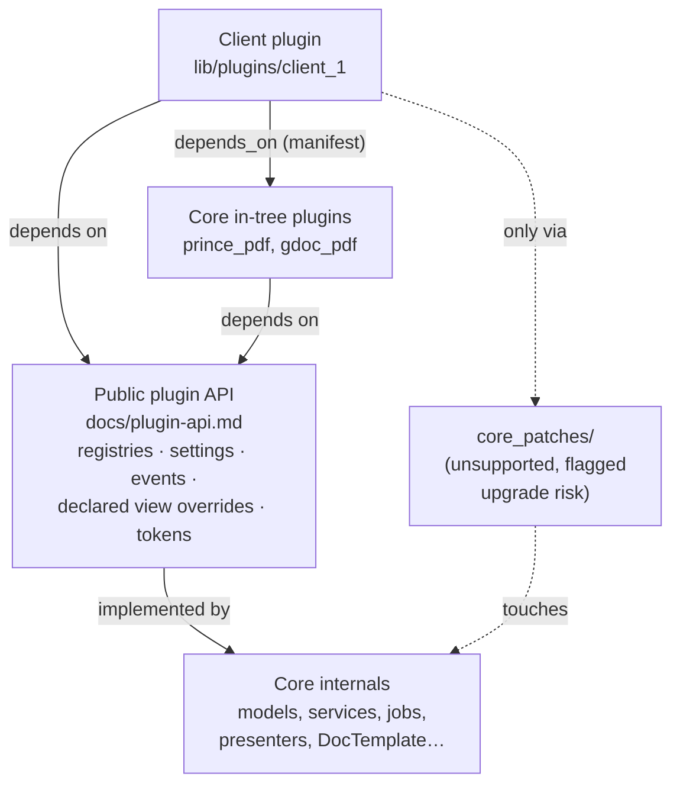

# ADR-0004: Stable Plugin API

|                   |                                                                                                                  |
|-------------------|------------------------------------------------------------------------------------------------------------------|
| **Status**        | Proposed                                                                                                         |
| **Date**          | 2026-09-25                                                                                                       |
| **Supersedes**    | —                                                                                                                |
| **Superseded by** | —                                                                                                                |
| **Related**       | [ADR-0003](./0003-client-distribution-and-release-model.md), [ADR-0001](./0001-pluggable-output-renderers.md), [docs/plugin-system.md](../plugin-system.md), [docs/plugin-api.md](../plugin-api.md) |

---

## 1. Context

[ADR-0003](./0003-client-distribution-and-release-model.md) makes each client a
private plugin on top of a versioned core. That model only keeps client
updates cheap if client plugins rely on a surface that core promises not to
break.

Today there is no such surface. [docs/plugin-system.md](../plugin-system.md)
describes plugins as having "full access" to all models, services and helpers.
Some well-shaped extension points already exist — the PDF renderer registry
(ADR-0001), `DocTemplate::Template.register_tag`, `PluginSystem::MenuRegistry`,
and `Settings` — but nothing distinguishes them from internals, and the areas
clients customize most (lesson and material templates, metadata) have no
supported extension point at all.

This was the original intent for LCMS Core: plugins were meant to have a
stable, well-defined API, and clients should rarely, if ever, need to go
outside it.

## 2. Decision

### 2.1 Public vs internal

Core code is divided into two categories:

- **Public plugin API** — the extension points listed in
  [docs/plugin-api.md](../plugin-api.md). Only what is listed there is public.
- **Internal** — everything else, including all models, services, jobs,
  presenters, views and `DocTemplate` classes not listed as public. Internals
  may change in any release.

"Full access" is removed from the plugin documentation. Plugins *can* still
reach internals (it is Ruby), but doing so is unsupported: see 2.4.

Dependency direction:

Rules:

- Core never depends on a client plugin.
- A client plugin depends on the public API and, optionally, on core in-tree
  plugins (declared with `depends_on`).
- Anything that touches internals lives in `core_patches/` and is part of the
  per-release risk review.

### 2.2 Shape of the API

Extension points follow the patterns already established in core, in order of
preference:

1. **Settings** — data-only customization, edited in admin, no plugin needed.
2. **Registries** — a plugin registers an implementation of a documented
   contract (`PluginSystem::Registry`-style: protocol-verified registration,
   `identifier`, optional `available?`). Examples: PDF renderers, tags,
   metadata schemas, menu items.
3. **Declared view overrides** — a documented list of partials that a plugin
   may override. Plugin view paths for these are *prepended* so the plugin
   wins. Each overridable partial documents its locals, which are part of the
   API.
4. **Hooks** — named, documented callbacks at defined pipeline stages (e.g.
   after a document is parsed, before a material is rendered), for cases a
   registry does not fit. Implemented with `ActiveSupport::Notifications` or a
   small hook registry; payloads are part of the API.

Every public extension point has:

- a documented contract (methods, arguments, return values, locals/payloads);
- RBS signatures under `sig/` (consistent with ADR-0001);
- a **contract spec** in core that exercises it with a test plugin, so core CI
  fails when the contract breaks.

### 2.3 Versioning and deprecation

The plugin API follows core's semver (ADR-0003):

| Change to the plugin API                        | Release type |
|-------------------------------------------------|--------------|
| New extension point, new optional argument       | Minor        |
| Deprecation (old path still works, warns)        | Minor        |
| Removal or incompatible change                   | Major        |
| No plugin API change                             | Patch/minor  |

- A deprecated extension point keeps working for at least one minor release
  and logs a deprecation warning naming the replacement.
- Release notes state the plugin API impact of every release.
- Plugins declare the core range they support (`requires_core`, ADR-0003);
  boot fails outside that range.

### 2.4 Going outside the API

Sometimes a client needs something the API does not cover. The rule:

1. **First, ask whether it belongs in the API.** If the need is plausibly
   shared, extend core with a new extension point or setting instead.
2. **If it is truly client-specific**, the plugin may patch internals, but:
   - the patch lives in a single, clearly named place in the plugin
     (e.g. `lib/<plugin>/core_patches/`), one file per patched core class;
   - each patch has a spec that fails loudly if the patched method or view
     disappears or changes shape (no silent fallbacks);
   - the patch list is part of the risk review for every core release
     (ADR-0003 §2.5).
3. Patches are **upgrade risk**, visible to the business and priced as
   ongoing maintenance.
4. A patch needed by two or more clients is a signal to turn it into an
   extension point.

## 3. Consequences

### Positive

- Core can refactor internals freely without breaking clients.
- Client plugin breakage is concentrated at a documented, tested surface.
- The API grows from real client needs instead of speculative design.
- The number of patches per client is a measurable indicator of upgrade cost.

### Negative

- Core must design, document and test each extension point up front; some
  client requests will wait for an extension point instead of being patched
  directly.
- Contract specs, RBS signatures and deprecation shims add maintenance to core.
- The initial API will not cover everything; early clients will need a few
  patches until it matures.

## 4. Alternatives considered

### A. Keep "full access" and rely on client CI

Client CI (ADR-0003) catches breakage but does not reduce it. With no stable
surface, most core releases would require plugin fixes for most clients —
the lcms-engine situation again.

### B. Separate plugin SDK gem with its own version

A versioned SDK gem wrapping core would formalize the boundary, but duplicates
core's release process for little gain while plugins run in-process in the same
application. Revisit if the API becomes large.

### C. Configuration-only customization (no code plugins)

Too restrictive: legacy clients required custom tags, metadata handling and
templates that cannot be expressed as settings.

## 5. Migration plan

1. Draft the initial API surface in [docs/plugin-api.md](../plugin-api.md),
   based on what legacy clients actually customized.
2. Mark existing extension points (renderer registry, tag registry, menu
   registry, settings) as public; add RBS and contract specs where missing.
3. Add the missing extension points in priority order (lesson/material
   template overrides and metadata first).
4. Update [docs/plugin-system.md](../plugin-system.md): remove "full access",
   link the API, document the patch policy.
5. Convert `plugin_demo`, `prince_pdf` and `gdoc_pdf` to use only public API
   as the reference examples.

## 6. Open questions

- Hook mechanism: `ActiveSupport::Notifications` (instrumentation semantics,
  cannot change results) vs a small hook registry that can transform values?
- Should overridable view partials be versioned individually, or covered by
  core's semver alone?
- How strictly to enforce the patch policy — convention and review, or a
  check in client CI?
